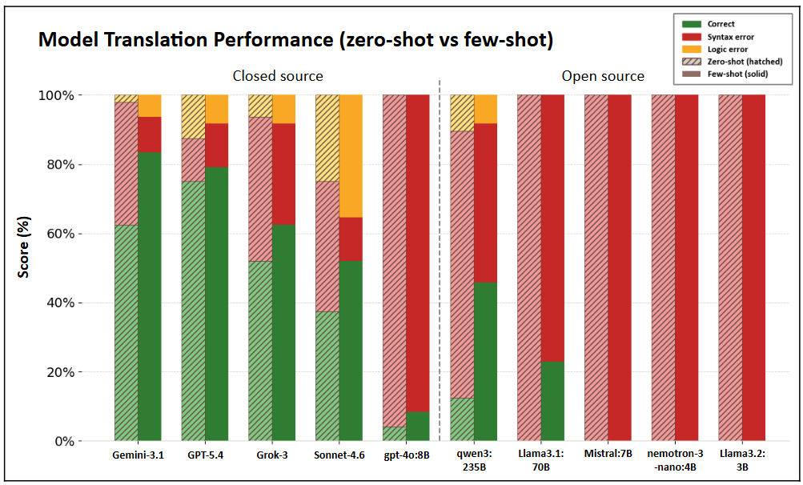

# NL2AGBench: Benchmarking LLM Auto-Formalization for AlphaGeometry

*Figure 1: The translation gap between natural-language geometry problems and AlphaGeometry's formal DSL. While AlphaGeometry has demonstrated strong theorem-proving capabilities, the manual formalization step remains a major barrier to usability and large-scale deployment.*

## Benchmark Construction

NL2AGBench is built from geometry problems originally formalized for AlphaGeometry:

- **Source**: The Java Geometry Expert (JGEX) repository, from which the AlphaGeometry project manually formalized 231 problems into its DSL.
- **Selection**: 48 representative problems were selected for translation diversity (circles, cyclic quadrilaterals, angle bisectors, orthocenters, circumcenters, midpoints, reflections, perpendicular constructions) and execution efficiency (excluding problems with excessive AlphaGeometry runtime).
- **Format**: Every problem pairs a natural-language statement with a verified, executable AlphaGeometry translation.

*Figure 2: Sample NL2AGBench problems spanning a range of geometric concepts, selected for both diversity and runtime efficiency.*

## Evaluation Method

Translation quality is judged with **execution-based evaluation** rather than string/textual similarity, since two syntactically different DSL outputs can be semantically equivalent. Each generated translation is run directly inside AlphaGeometry and the outcome is bucketed into one of three classes:

- **Successful Translation** — the specification parses and executes correctly.
- **Syntax Error** — the DSL violates AlphaGeometry's grammar or construction rules (further split into `AssertionError`, `KeyError`, and `ValueError` cases in the error taxonomy).
- **Logic Error** — the specification is syntactically valid but semantically inconsistent with the source problem (e.g. wrong predicate, omitted constraint, misread geometric relationship). Runs that hang without output for 5+ minutes are also classified as logic errors.

We evaluate **10 state-of-the-art LLMs** (closed- and open-source, spanning multiple parameter scales) using this framework.

**Table 1. Zero-Shot Model Performance**

| Closed Source | Correct | Open Source | Correct |
|---|---|---|---|
| GPT-5.4 | 75.00% | Qwen3:235B | 12.50% |
| Gemini 3.1 | 62.50% | Llama3.1:70B | 0% |
| Grok-3 | 52.08% | Llama3.2:3B | 0% |
| Sonnet 4.6 | 37.50% | Mistral:7B | 0% |
| GPT-4o:8B | 4.17% | Nemotron-3 Nano:4B | 0% |

## Improving Translation Performance

Three mitigation strategies were tested on top of the zero-shot baseline: few-shot prompting, human-guided hints, and supervised fine-tuning.

### Few-Shot Prompting

Each model was given 54 reference examples pairing natural-language problems with verified AlphaGeometry translations, exposing it to common constructions, DSL syntax patterns, and proof predicates. This was the most scalable and consistently effective intervention, improving nearly every model without any retraining — with the largest relative gains among open-source models.

**Table 2. Zero-Shot vs. Few-Shot Performance**

| Model | Zero-Shot | Few-Shot | Change |
|---|---|---|---|
| Gemini 3.1 | 62.5% | 83.3% | +20.8 pts |
| GPT-5.4 | 75.0% | 79.2% | +4.2 pts |
| Grok-3 | 52.1% | 62.5% | +10.4 pts |
| Sonnet 4.6 | 37.5% | 52.1% | +14.6 pts |
| GPT-4o:8B | 4.2% | 8.3% | +4.1 pts |
| Qwen3:235B | 12.5% | 45.8% | +33.3 pts |
| Llama3.1:70B | 0% | 23% | +23 pts |
| Mistral:7B | 0% | 0% | — |
| Nemotron-3 Nano:4B | 0% | 0% | — |
| Llama3.2:3B | 0% | 0% | — |

Improvements were most pronounced on syntax-related failures, suggesting a meaningful share of translation errors stem from unfamiliarity with AlphaGeometry's DSL rather than a lack of geometric understanding — especially for open-source models. A substantial gap to the strongest closed-source models nonetheless remained.

### Human-Guided Hints

A two-stage correction framework was applied after the initial translation attempt:

1. **Stage 1 — Diagram-Based Hints**: the model is shown a geometric diagram of the target problem and asked to re-evaluate its translation, supplying spatial context (collinearity, circle membership, auxiliary constructions) that's often implicit in the figure but underspecified in text.
2. **Stage 2 — Error-Specific Hints**: if needed, a targeted hint identifies the specific issue (e.g. wrong argument count, misused predicate, invalid construction) and the model revises just that part of its translation.

This staged approach improved translation accuracy across every evaluated model:

| Model | Improvement |
|---|---|
| Grok-3 | +32.14% |
| Sonnet 4.6 | +26.47% |
| Gemini 3.1 | +14.63% |
| GPT-5.4 | +14.29% |

Hints were most effective for strong frontier models whose initial translations were already close to correct — narrowing the search space let them recover rather than requiring them to re-derive the whole formalization. The approach is effective as a diagnostic/correction tool but doesn't scale well on its own, since it requires supplying diagrams and manually inspecting model outputs.

### Supervised Fine-Tuning

Smaller open-source models were fine-tuned on **HAGeo-409**, a human-verified set of geometry problems paired with AlphaGeometry formalizations. Fine-tuning improved adherence to DSL grammar and reduced several classes of syntax errors, but gains in overall executable-translation accuracy were limited. Qualitative review showed fine-tuned models often learned surface-level DSL patterns without reliably capturing the underlying geometric semantics — producing syntactically plausible but semantically wrong constructions. This suggests the bottleneck for smaller models isn't just DSL familiarity but also limited reasoning capacity.

## Takeaways

- A substantial performance gap persists between frontier closed-source models and open-source alternatives on geometry auto-formalization.
- Few-shot prompting is the most scalable, broadly effective mitigation.
- Human-guided hints are highly effective for near-correct translations but don't scale to large benchmark runs.
- Fine-tuning helps with syntax but not with the deeper geometric reasoning needed for semantic correctness.
- The syntax/logic error taxonomy is useful for diagnosing *why* a translation failed, not just whether it did.

## Future Work

Extending NL2AGBench to other theorem-proving systems, incorporating diagrams directly via multimodal formalization, building specialized auto-formalization models, and adding symbolic feedback loops for iterative self-correction.
